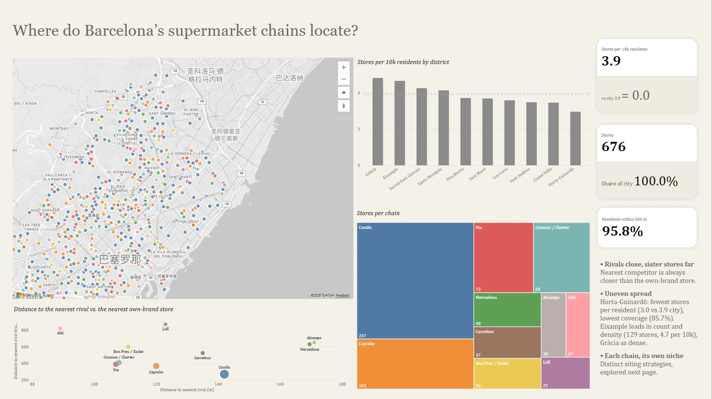
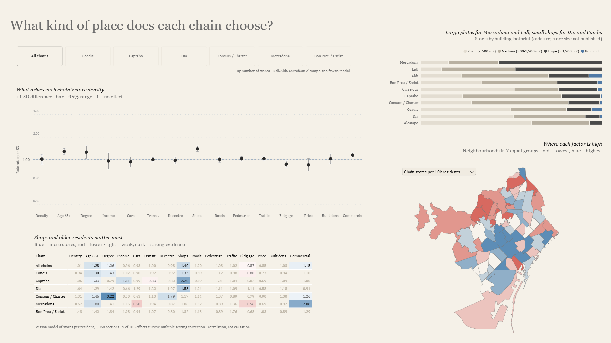
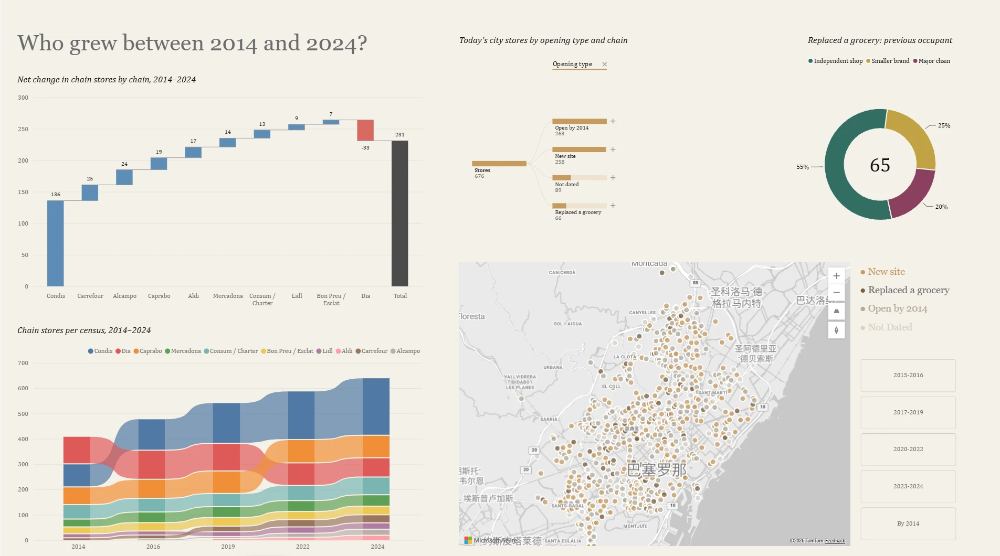
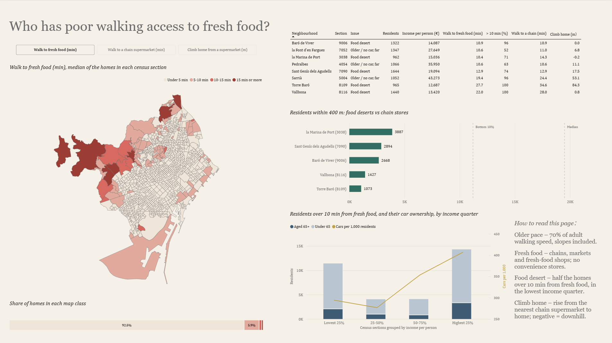
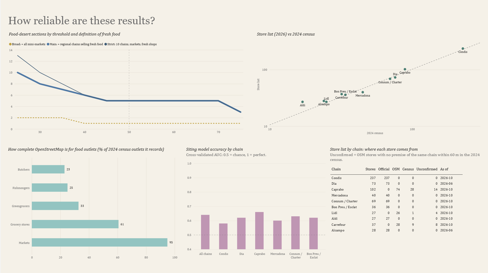
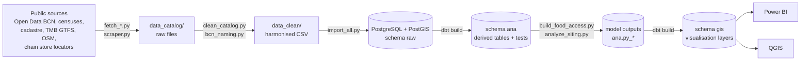

# Where do Barcelona's supermarket chains locate, and who is left out?

An end-to-end spatial analysis of the **676 stores of the 10 largest supermarket chains in the city of Barcelona** (October 2026):
where they are, what kind of place each chain chooses, who grew between 2014 and 2024, which residents have poor walking access
to fresh food, and how reliable these results are.

**Stack:** Python (scrapers, spatial analysis, statistical models) · PostgreSQL 18 + PostGIS 3.6 · dbt-core 1.12 · Power BI · QGIS

---

## Key findings

- **Coverage is dense but uneven.** 3.9 chain stores per 10,000 residents; 95.8% of residents live within 500 m of one.
  Horta-Guinardó has the fewest stores per resident (3.0) and the lowest coverage (85.7%).
- **Growth was driven by one chain.** Chain premises in the commercial census rose from 408 (2014) to 639 (2024), +57%;
  Condis alone added 136 (59% of the net growth) while Dia lost 33. About one dated opening in five took over an existing grocery
  (15–29% depending on the matching distance).
- **Chains follow shops and older residents.** In a Poisson model of stores per resident (1,068 census sections), the density of
  commercial premises and the share of residents aged 65+ are the only effects with strong evidence across chains
  (9 of 105 effects survive false-discovery correction). The model captures tendencies, not exact sites (cross-validated AUC 0.58–0.66).
- **Tourist areas are served by independent mini-markets, not by chains** (except Condis' recent openings).
- **Fresh food is close for almost everyone.** 91% of homes are within a 5-minute walk of fresh food at an older person's pace
  (slope-aware street network). **5 low-income food deserts** (6,300 residents) remain on the hilly or industrial edge of the city:
  too few people live within 400 m of them (1,100–3,900) to support a supermarket, against 11,200 around the smallest 10% of chain stores.

## Dashboard

Five Power BI pages. The report file (`.pbix`) is not in the repository because it embeds all data; the theme is in
[`dashboard/theme_supermarket_bcn.json`](dashboard/theme_supermarket_bcn.json).

**01 Where do the chains locate?** Store map, stores per district and per chain, nearest rival vs nearest own-brand store.


**02 What kind of place does each chain choose?** Model effects per chain (forest plot and heat map), building size by chain, factor map.


**03 Who grew between 2014 and 2024?** Net change per chain, chain stores per census, opening types, previous occupants of taken-over sites.


**04 Who has poor walking access to fresh food?** Switchable map (walk to fresh food / to a chain / climb home), flagged sections, catchment vs chain stores, income quarters.


**05 How reliable are these results?** Food-desert sensitivity, store list vs census, OpenStreetMap completeness, model accuracy, store sources.


## Pipeline



1. **Collect** – `fetch_*.py`, `scraper.py`: store lists from the chains' official store locators (Mercadona, Aldi, Condis, Consum,
   Bon Preu, Dia, Alcampo), OpenStreetMap for chains without a usable list, and open data (population, income, commercial censuses
   2014–2024, cadastre, zoning, transit, traffic, tourism). No bot protection is bypassed; store floor areas are not scraped.
2. **Clean** – `clean_catalog.py` with the rules in `bcn_naming.py`: UTF-8, one Catalan name for shared concepts
   (`codi_barri`, `seccio_censal` …), units in column names, consistent types.
3. **Load** – `import_all.py` into PostgreSQL/PostGIS (`raw` schema, EPSG:25831).
4. **Transform** – the dbt project in [`dbt_bcn/`](dbt_bcn) builds every derived table: `ana` (stores, census panels, population,
   transit service, model tables), `dbt_int` (helpers) and `gis` (curated layers for Power BI and QGIS), with primary keys and tests.
5. **Analyse** – `build_food_access.py` (walking network with Tobler slope speeds and an older-pace variant), `analyze_siting.py`
   (Poisson models with barri-clustered errors, Benjamini–Hochberg correction, hold-out and spatial cross-validation),
   `analyze_tourism_markets.py`, `food_desert_viability.py`; `load_model_outputs.py` writes the results back for dbt.
6. **Check** – `check_quality.py` (descriptions, geometry, keys, codes, totals, ranges, catalogs, dbt tests, an independent
   re-verification) and `docs/data_catalog_supermarket_bcn.xlsx` (every table and column).
7. **Visualise** – Power BI reads the `gis` schema; QGIS opens the same layers through a PostGIS connection;
   `export_dashboard_boundaries.py` writes simplified boundaries (GeoJSON / TopoJSON) for Power BI maps.

## Store list audit

The store list was checked against two independent sources before any analysis:

- **Official store locators** for 7 chains (510 stores); OpenStreetMap lists of Mercadona and Aldi were checked store by store
  against their locators (closed stores dropped, missing ones added).
- **Commercial census 2024** (a municipal survey of every ground-floor premise): 84% of stores have a premise of the same chain
  within 60 m; 38 stores missing from OpenStreetMap were added from it.
- 57 Clarel drugstores listed as "Dia" and 10 closed or duplicate stores were removed, with the evidence in
  [`store_removals_manual.csv`](data_catalog/01_stores/store_removals_manual.csv).
- Remaining uncertainty: 26 stores of Caprabo, Carrefour and Lidl (OpenStreetMap only) are not confirmed by the 2024 census.

## Limitations

- Correlation, not causation: the siting model describes where stores are, not why a given site was chosen.
- Store floor areas are not published; building footprints from the cadastre are used as a proxy.
- Outside the city only OpenStreetMap is available, and it records only 23–33% of fresh-food shops: access near the city edge
  may be underestimated.
- 89 city stores cannot be dated from the commercial censuses.

## Data sources

| Source | Content | Licence |
|---|---|---|
| [Open Data BCN](https://opendata-ajuntament.barcelona.cat/) | census sections, population (Padró), income, commercial censuses 2014–2024, markets, tourist flats, traffic, pacified streets | CC BY 4.0 |
| [Dirección General del Catastro](https://www.catastro.hacienda.gob.es/) | INSPIRE buildings | open, with attribution |
| [TMB](https://developer.tmb.cat/) | GTFS timetable | open, with attribution |
| [OpenStreetMap](https://www.openstreetmap.org/) | stores, food shops and roads around the city | ODbL |
| [Copernicus GLO-30](https://spacedata.copernicus.eu/) | terrain for walking slopes | free, with attribution |
| [Inside Airbnb](http://insideairbnb.com/) | listings and reviews (host data not kept) | CC BY 4.0 |
| Chain store locators | store locations of the 10 chains | used for analysis only, not redistributed |

Raw and scraped data are not included in the repository; the `fetch_*.py` scripts download them again.

## Reproduce

```bash
python -m venv .venv && .venv\Scripts\pip install -r requirements.txt
python -m venv .venv-dbt && .venv-dbt\Scripts\pip install -r dbt_bcn\requirements.txt
# PostgreSQL + PostGIS on localhost:5432, database supermarket_bcn; password in %APPDATA%\postgresql\pgpass.conf (never in the repo)

# 1. download inputs (once; see docs/DATABASE_GUIDE.md for the full list)
.venv\Scripts\python fetch_history.py
.venv\Scripts\python fetch_official_locators.py
.venv\Scripts\python refresh_store_list.py
.venv\Scripts\python fetch_ring_stores.py
.venv\Scripts\python fetch_ring_osm.py
.venv\Scripts\python fetch_ring_food_osm.py
# 2. build
.venv\Scripts\python clean_catalog.py
.venv\Scripts\python import_all.py            # loads raw data and runs dbt build
.venv\Scripts\python build_food_access.py     # walking access, rebuilds the gis layers
.venv\Scripts\python analyze_siting.py
.venv\Scripts\python load_model_outputs.py
.venv\Scripts\python analyze_tourism_markets.py
.venv\Scripts\python food_desert_viability.py
.venv\Scripts\python export_dashboard_boundaries.py
# 3. check
.venv\Scripts\python check_quality.py
```

## Repository layout

| Path | Content |
|---|---|
| `*.py` (root) | pipeline scripts: collection, cleaning, loading, analysis, checks |
| `dbt_bcn/` | dbt project: `models/ana`, `models/intermediate`, `models/gis`, `seeds/`, `macros/` |
| `sql/legacy_pre_dbt/` | the SQL scripts that dbt replaced, kept for reference |
| `docs/` | [project report](docs/PROJECT_REPORT.md), [model results](docs/MODEL_RESULTS.md), [dashboard design](docs/DASHBOARD_DESIGN.md), [census guide](docs/CENSUS_GUIDE.md), [database guide](docs/DATABASE_GUIDE.md), [work log](docs/WORK_LOG.md), data catalog (xlsx), model outputs (csv) |
| `dashboard/` | Power BI theme and map boundaries |

## Copyright

© 2026 Ziyue Zhou. All rights reserved. The code, documents and dashboard design may be viewed for evaluation only;
copying, modifying or redistributing them requires written permission. See [`LICENSE`](LICENSE).
The input data remain under the licences of their sources (see *Data sources*).
